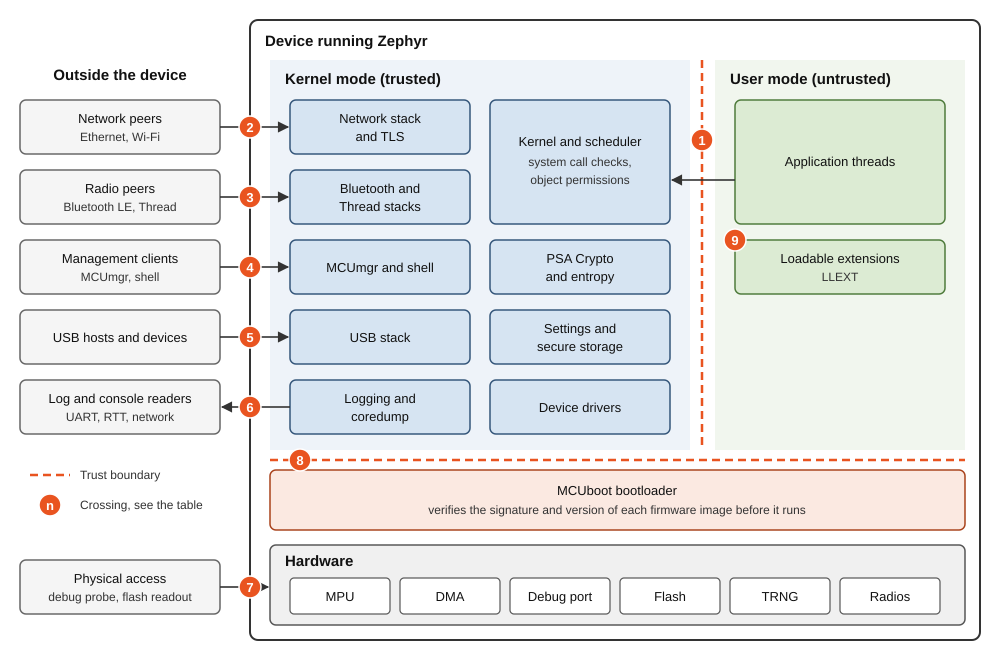
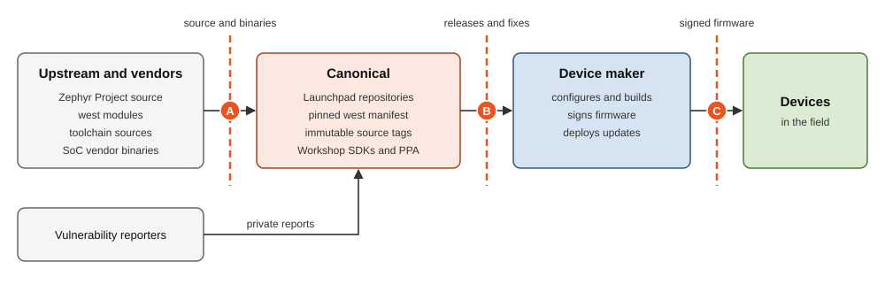

.. _exp_security_system_overview:

.. meta::
   :description: The components of a device built on Zephyr LTS and of its
                 supply chain, the trust boundaries between them, and the
                 security controls that protect each boundary.

System overview
===============

The system has two parts:

* The **firmware**: the Zephyr kernel, its subsystems and modules,
  the MCUboot bootloader, and your application, running on a device.
* The **supply chain**: the repositories, tools, and processes that deliver
  |product_name| to you, and your firmware to devices.

Firmware
--------

Zephyr builds the kernel, drivers, protocol stacks, and application into a
single firmware image. There are no processes or dynamically loaded programs,
unless you add loadable extensions (LLEXT).
The following diagram shows the components of a device
and the trust boundaries between them.

         the device boundary to kernel-mode protocol stacks. A system call
         boundary separates kernel mode from user-mode threads and loadable
         extensions. MCUboot verifies firmware before it runs. Numbered
         markers identify nine trust boundaries.
   :width: 100%

   Trust boundaries in a device running |product_name|

Data that crosses a trust boundary comes from a less trusted source,
so the receiving side must validate it:

.. list-table::
   :header-rows: 1
   :widths: 5 20 75

   * - #
     - Boundary
     - What crosses it
   * - 1
     - System calls
     - Pointers, lengths, and object handles that user-mode threads pass to
       the kernel. This boundary only exists when user mode is enabled.
   * - 2
     - Network
     - Ethernet and Wi-Fi traffic, including TLS sessions, from any host
       that can reach the device. The traffic is unauthenticated
       until the application authenticates the peer.
   * - 3
     - Radio
     - Bluetooth LE, IEEE 802.15.4, and Thread frames from any device in
       radio range, unauthenticated before pairing or commissioning.
       On RW612, ESP32-C3, and ESP32-S3, closed-source vendor radio code
       processes these frames before Zephyr does.
   * - 4
     - Management
     - MCUmgr commands over Bluetooth LE, UDP, or UART, and shell commands.
       These commands can upload firmware, reset the device,
       and read or write files and settings.
   * - 5
     - USB
     - Descriptors and class data from whatever is plugged into the USB port.
   * - 6
     - Logs and console
     - Log messages, shell output, and coredumps that leave the device.
       They can contain kernel and application state.
   * - 7
     - Physical access
     - Memory and register access through an unlocked debug port,
       direct reads and writes of flash,
       and DMA transfers that bypass the MPU.
   * - 8
     - Boot
     - Firmware images that MCUboot must verify before they run.
   * - 9
     - Loadable extensions
     - ELF files that LLEXT links into the running firmware.

.. _exp_security_user_mode:

Kernel and user mode
--------------------

By default, every Zephyr thread runs in kernel mode with access to all memory.
When you enable user mode, Zephyr uses the memory protection unit (MPU)
to confine each user-mode thread to the memory partitions that it was granted.
User-mode threads reach kernel services only through system calls,
and the kernel validates every argument they pass.
A bug in a user-mode thread then can't corrupt the kernel
or read another thread's secrets.

Memory protection support differs across the supported platform set:

.. list-table::
   :header-rows: 1
   :widths: 25 40 35

   * - Platform
     - Memory protection used by Zephyr
     - User mode
   * - nRF52840
     - MPU
     - Available
   * - STM32H753ZI
     - MPU
     - Available
   * - RW612
     - MPU
     - Available
   * - RA8M1
     - MPU
     - Available
   * - ESP32-C3
     - None
     - Not available
   * - ESP32-S3
     - None
     - Not available

On ESP32-C3 and ESP32-S3, every thread and every loadable extension runs
with kernel privilege. A memory-safety bug anywhere in the firmware
can compromise the whole device.

MPU isolation is coarse: the number of MPU regions limits
how finely you can partition memory.

None of the supported platforms runs a secure processing environment such as
Trusted Firmware-M (TF-M). RW612 and RA8M1 have TrustZone-capable cores,
but upstream Zephyr provides no non-secure board targets for them.
Secrets therefore rely on Zephyr's own storage
and the SoC's cryptographic hardware rather than on an isolated secure world.

Supply chain
------------

The following diagram shows how source and fixes reach your devices:

         upstream projects and vendors to Canonical, releases and fixes flow
         from Canonical to the device maker, and signed firmware flows from
         the device maker to devices. Vulnerability reporters send private
         reports to Canonical.
   :width: 100%

   The |product_name| supply chain

.. list-table::
   :header-rows: 1
   :widths: 5 30 65

   * - #
     - Boundary
     - Protection
   * - A
     - Upstream to Canonical
     - Upstream Zephyr requires code review and runs static analysis
       and fuzzing. Canonical pins every repository revision in its west
       manifest and tests the supported platforms on physical hardware.
       Each module pins its vendor binaries by SHA-256 checksum,
       which :command:`west blobs` checks when it fetches them.
   * - B
     - Canonical to you
     - Each update is an immutable source tag that pins every repository
       revision. Updates reach you only when you move your workspace to a new
       tag. :command:`apt` verifies the signature of the PPA packages.
   * - C
     - You to devices
     - You sign firmware images with your own key,
       and MCUboot verifies them on the device.

.. _exp_security_controls:

Security controls
-----------------

The threat model identifies the following controls. In the **Who enables it**
column, *built in* controls work without extra configuration,
*you enable* controls are part of Zephyr but depend on your configuration,
and *you deploy* controls need keys, hardware settings,
or application code from you.
:ref:`how_harden_an_application` shows how to apply the controls
that you enable or deploy.

.. list-table::
   :header-rows: 1
   :widths: 22 58 20

   * - Control
     - How it helps
     - Who enables it
   * - Input validation in protocol stacks
     - The network, Bluetooth, Thread, and USB stacks check lengths and
       offsets before they use them, so malformed input is rejected
       instead of corrupting memory.
     - Built in
   * - System call validation
     - The kernel checks every pointer, length, and object handle that a
       user-mode thread passes in, so a faulty or malicious thread can't make
       the kernel access memory that the thread doesn't own.
     - Built in, when user mode is enabled
   * - User mode and memory domains
     - The MPU confines each user-mode thread to its granted memory, and
       kernel object permissions limit which threads can use which kernel
       objects. A compromised thread can't read secrets
       or change kernel data.
     - You enable, on MPU platforms
   * - Stack protection
     - Stack guards, canaries, and sentinels detect stack overflows
       before they corrupt adjacent memory.
     - You enable
   * - Bounded resource use
     - Fixed-size buffer pools and connection limits keep a flood of
       traffic from exhausting memory.
     - Built in; you size the pools
   * - Storage integrity checks
     - The settings, NVS, and ZMS storage backends check stored records
       for corruption when they load them.
     - Built in
   * - Cryptography and entropy
     - The PSA Crypto API, implemented by Mbed TLS, provides standard
       algorithms. Entropy drivers seed it from the SoC's hardware random
       number generator.
     - Built in; you must not ship the test random generator
   * - Verified boot
     - MCUboot checks each image's signature, and optionally its version,
       before running it. Only images that you signed can run, and older
       vulnerable versions can't be reinstalled.
     - You deploy your signing keys
   * - TLS peer verification
     - TLS sockets can require a valid certificate and a matching host
       name, which stops an attacker from impersonating your server.
     - You enable
   * - Bluetooth LE Secure Connections and privacy
     - Secure Connections Only mode prevents downgrades to legacy pairing.
       Resolvable private addresses stop observers from tracking
       a device by its address.
     - You enable
   * - Authenticated device management
     - MCUmgr has no authentication of its own. Running it only over
       encrypted, authenticated transports, and disabling the command
       groups you don't need, keeps unauthorized clients
       from controlling the device.
     - You deploy
   * - Secure storage
     - The PSA Secure Storage implementation encrypts and authenticates
       stored secrets, so a flash dump doesn't reveal them in plaintext.
     - You enable
   * - Debug port lockdown
     - Locking SWD/JTAG stops someone with physical access from reading
       memory or taking control of the CPU.
     - You deploy; specific to each SoC
   * - DMA restrictions
     - Restricting DMA-capable peripherals to dedicated buffers stops them
       from reading or writing kernel memory without MPU checks.
     - You deploy; specific to each SoC
   * - Production diagnostics lockdown
     - Disabling or restricting the shell, verbose logging, and coredumps
       stops them from leaking secrets or giving anyone a console.
     - You enable
   * - Extension verification
     - LLEXT doesn't verify extensions. Checking each extension's signature
       before you load it, and loading it into a user-mode memory domain,
       stops untrusted code from running with kernel privilege.
     - You deploy

See also
--------

Explanation:

- :ref:`exp_security_risks`
- :ref:`exp_security_data`

How-to guides:

- :ref:`how_harden_an_application`

Reference:

- :ref:`ref_supported_boards`
- :zephyr-docs:`Upstream Zephyr user mode documentation <kernel/usermode/index.html>`
